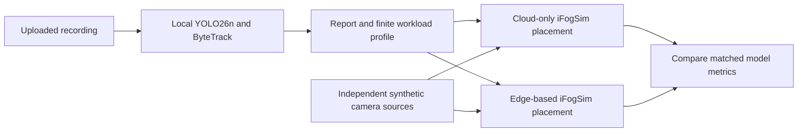

# Demonstration script

Use this as a short local walkthrough; processing time depends on the recording and machine. The formal report/slides are deferred. Do not promise a fixed completion time or call the prototype a deployed CCTV network.

## Prepare

Follow [setup](SETUP.md), complete model download/build, and start one idle local server. Use permissioned recordings if available, or explicitly name the bundled clip as a synthetic moving-shape fixture. Generate the second fixture before the demonstration when needed:

```powershell
.\video_analytics\.venv\Scripts\python.exe video_analytics/tests/make_multi_camera_fixture.py
```

The files are `video_analytics/tests/fixtures/synthetic_test_clip.avi` (20 frames, 10 FPS) and ignored `video_analytics/tests/.runtime/second-camera.avi` (12 frames, 4 FPS). They are 160x120 integration fixtures, not accuracy datasets. UI uploads use the normal unlabeled classification; explicitly marked test API uploads have separate synthetic provenance. Tell the audience which inputs you use.

## 1. Explain the boundary

Say: "Python performs real local object detection, tracking and configured rules. iFogSim separately models where the resulting workload would run. It receives profiles, not video frames."



## 2. Demonstrate neutral state and virtual cameras

1. Refresh. Point out empty cards/charts/table: old disk files are not displayed as a new run.
2. Select six virtual cameras. Expected workload becomes 900 tuples (six distinct sources x 150).
3. Choose **Run both scenarios**. Show Running with prior values cleared, then the actual completed pair and 900 arrivals per placement.
4. Explain full-loop versus detector-arrival endpoints. Latency is raw simulator time; runtime is wall-clock milliseconds. Traffic/energy are modeled.
5. Change camera count. The comparison clears because that new configuration has not run.

Do not claim edge always wins. If discussing the retained evaluation, show [the actual Stage 7 results](../simulation/experiments/STAGE7_EVALUATION.md): edge reduced detector arrival/traffic but increased full-loop latency; energy outcomes depend on case.

## 3. Demonstrate single recording

Select a local clip and click **Start Analysis**. Explain the indeterminate progress bar; the prototype does not provide reliable frame-percent progress. Wait for local analysis and both simulations. Review observations versus unique track IDs, processing duration/FPS, rule-coverage note and JSON download.

If default regions are empty, say: "Region-based rules were not evaluated. Zero events does not establish safety." A moving-shape fixture may yield no supported-class detections; do not invent expected counts or substitute detections from another clip.

Show that recording comparison controls refer to that job. Switch with **Use virtual-camera simulation**, then **Show video comparison**. Neither operation reruns inference or substitutes standalone history for the recording.

## 4. Demonstrate multiple recordings and recovery

Choose the two fixtures under **Multiple camera recordings** and start analysis. Show independent camera/job IDs, sequential progress and individual **View analytics** actions. The fixture pair produces 20+12=32 tuples under default one-frame batching and retains separate 0.1/0.25-second intervals. Explain that the shared modeled start is not proof that footage is synchronized.

Open one camera's analytics. The combined comparison remains selected. Explain that aggregate track IDs are camera-scoped sums, not cross-camera re-identification. Save the displayed batch ID.

Refresh to show neutral state. Enter that ID in **Recover a recording batch by ID** and load it explicitly. For a restart demonstration, stop the idle server with Ctrl+C, restart it, and load the same ID; never stop active processing to manufacture a completed recovery.

## 5. Optional failure demonstration

Use a previously verified test batch or an intentionally invalid copy only in a dedicated test environment. A partial batch excludes failed inputs while showing their errors. An all-failed batch runs no comparison. A simulation failure after successful analytics preserves reports. Do not rename the simulation script or edit configuration during a live presentation; those failure injections belong to the integration suite.

If Chart.js is unavailable, the dashboard notice explains that cards/table remain usable. If AVI preview is unsupported, distinguish browser preview from Python decode support.

## Close with verified scope

Say: "The prototype implements local uploaded-video analytics and reproducible placement simulations, including multiple recordings and validated recovery. Physical RTSP cameras, distributed YOLO execution, hardware calibration and labeled CCTV accuracy evaluation remain future work."

Keep [viva notes](VIVA_GUIDE.md) and [evidence links](../README.md#evidence-map) available for follow-up questions. Do not present the selected paper's gains as EdgeVision's own results.
