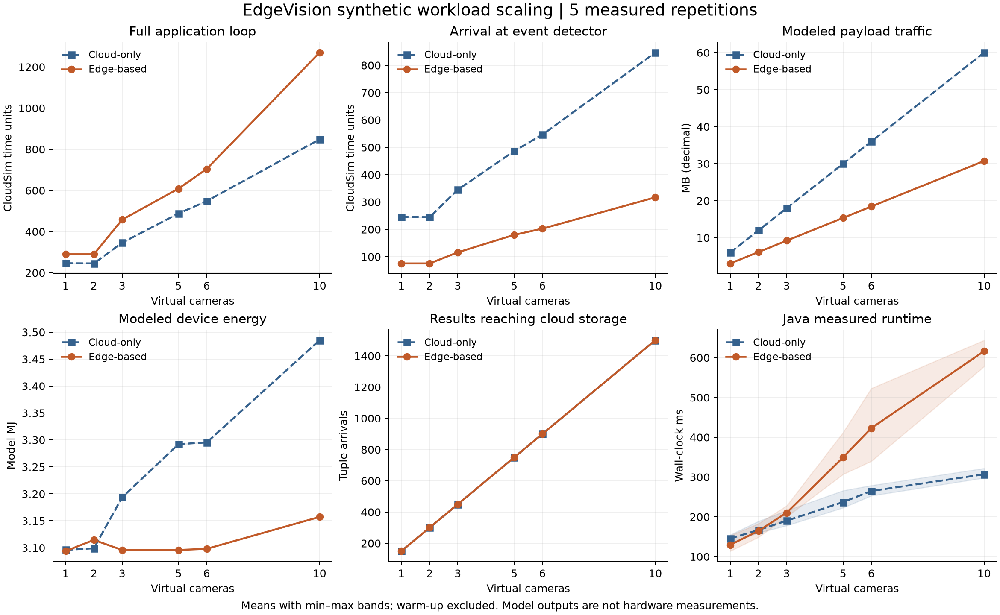

# Stage 3 multi-camera experiments and analysis

Five measured repetitions were completed for each of six camera counts and two placements on 2026-11-17: **60 measured fresh-JVM simulations**, plus one excluded five-camera warm-up pair. The tested production commit is `37fd6d79b7ad8ceeb655ee1ef0bee6aed3b4e268`; the pinned iFogSim revision is `5f68d3947e450d8d2b4af42670be819206be68c9`.

These are finite synthetic tuple workloads in iFogSim. No video was uploaded or processed, and YOLO/ByteTrack did not run. Results do not represent physical CCTV/cloud/fog hardware measurements or reproduce a reference paper's experiments.



## Experiment design

- Camera counts: 1, 2, 3, 5, 6 and 10; 150 tuples per camera, 0.1-second nominal interval, 15-second arrival window, 2,000-unit simulation horizon.
- One fixed profile ID and deterministic source trace per camera count across all repetitions. Cloud and edge receive exactly identical profiles; all pairs are checked for source IDs, timing/count settings and completed result arrivals.
- Each scenario runs in a separate Java process. Scenario order alternates between cloud-first and edge-first; camera-count order rotates between repetitions. The single warm-up pair can warm OS/file caches but cannot share JIT state between fresh JVMs.
- Windows; Node.js 22.21.0; Temurin OpenJDK 23.0.2+7. Exact OS/CPU/Python details, UTC execution times, production source SHA-256 hashes and execution order are retained in the raw evidence. Other host workloads were not controlled, so wall-clock results are descriptive observations on this machine.
- No production source, device specification, tuple demand, payload or placement assumption changed in Stage 3. The runner invokes the existing Java entry point directly, obtains actual stdout records and never reads or overwrites historical standalone/video results.

## Metric definitions and the latency-unit issue

**Latency numbers below are raw CloudSim time units, not verified milliseconds.** The legacy result keys `loopLatencyMs` and `analyticsLatencyMs` receive raw clock averages from [MetricsController](../src/main/java/com/edgevision/simulation/MetricsController.java) and [SimulationTelemetry](../src/main/java/com/edgevision/simulation/SimulationTelemetry.java); no milliseconds conversion occurs. The model also uses 0.1 clock units for its nominal 100 ms interval and MI/MIPS scheduling. Consequently, calling the raw clock differences milliseconds is inconsistent with the declared seconds-based workload. This report, chart and CSV label those values explicitly as simulator units and retain raw records unchanged. The existing dashboard still has `ms` labels; its unit contract must be corrected in an approved change before academic presentation. No hardware calibration is inferred here.

- Full application-loop latency: mean from camera emission to the result tuple reaching cloud storage, including the path after the event detector. It does not establish that the final storage computation finished.
- Event-detector-arrival latency: camera emission to arrival at `Event_Detector`; includes upstream delivery/analyzer work but excludes event-detector computation and subsequent cloud delivery. This is the legacy `analyticsLatencyMs` metric, not the complete analytics pipeline duration.
- Network: custom counted modeled payload traffic, in decimal MB. It excludes transport headers, deployment traffic and local module transfers.
- Energy: sum of device model energy counters, reported in model joules (tables use MJ); includes cloud and both fog devices over the established horizon, with no sensor power model. It is not a power-meter reading.
- Processed tuples: the existing counter observes result tuple arrivals at the cloud-storage module. These are not decoded video frames or confirmed storage-computation completions.
- Java wall-clock runtime: the existing `wallClockMillis` region from controller setup through metrics collection. It excludes build/JVM startup/topology construction and all video analysis. External Java subprocess elapsed time, including JVM startup, is retained separately as `driverWallClockMillis`.
- Internal simulation stop time: 2,000 CloudSim units in every run; this is neither the 15-second arrival window nor measured wall-clock runtime.

## Latency and workload results

All tuple counts matched in every measured run. Lower latency is preferable for the corresponding endpoint; neither endpoint should be substituted for the other.

| Cameras | Tuples per scenario | Full loop: cloud | Full loop: edge | Detector arrival: cloud | Detector arrival: edge |
|---:|---:|---:|---:|---:|---:|
| 1 | 150 | 246.597 | 290.293 | 245.635 | 75.398 |
| 2 | 300 | 245.637 | 290.293 | 244.634 | 75.398 |
| 3 | 450 | 345.946 | 458.140 | 344.947 | 116.019 |
| 5 | 750 | 488.544 | 609.212 | 486.526 | 179.947 |
| 6 | 900 | 548.566 | 704.798 | 546.532 | 202.621 |
| 10 | 1,500 | 848.517 | 1270.047 | 846.511 | 317.014 |

Edge lowered event-detector-arrival latency by 62.55-69.31%, but increased full-loop latency by 17.72-49.68%. At ten cameras, the full-loop means were 848.517 cloud and 1,270.047 edge; detector-arrival means were 846.511 cloud and 317.014 edge. The report therefore does not claim that edge always reduces end-to-end latency.

This trade-off is consistent with [the placement/topology](../src/main/java/com/edgevision/simulation/EdgeVisionSimulation.java): edge computes the analyzer and event detector on two 2,800-MIPS fog devices, while cloud has 44,800 MIPS. The result-storage destination remains in the cloud for both cases, so the edge full loop also includes detector work and the fog-to-cloud result path. The remaining mean path at ten cameras (full loop minus detector arrival) is about 953.033 units for edge versus 2.007 for cloud. These endpoint differences identify where the aggregate delay remains, but do not isolate service time versus individual queues; no causal percentage attribution is made. Upstream FogDevice dynamically allocates host MIPS to active modules, so the default 1,000-MIPS module declaration must not be treated as a fixed throughput cap.

Latency generally grows with load. The one/two-camera edge values are equal. A topology-consistent explanation is that named sources are distributed across two fog devices with deterministic phases, and the busiest fog's assigned source count remains one. This is an inference rather than an isolated causal test, and does not prove a general plateau for arbitrary workloads. The finite arrival burst and long loop delays do not demonstrate sustained real-time stream capacity.

## Network and energy

Signed energy change is `100 * (edge - cloud) / cloud`; positive means more modeled energy.

| Cameras | Cloud traffic (MB) | Edge traffic (MB) | Cloud energy (model MJ) | Edge energy (model MJ) | Edge energy change |
|---:|---:|---:|---:|---:|---:|
| 1 | 6.000 | 3.075 | 3.096184 | 3.093865 | -0.075% |
| 2 | 12.000 | 6.150 | 3.099008 | 3.114566 | +0.502% |
| 3 | 18.000 | 9.225 | 3.193555 | 3.095937 | -3.057% |
| 5 | 30.000 | 15.375 | 3.292202 | 3.095947 | -5.961% |
| 6 | 36.000 | 18.450 | 3.295375 | 3.098035 | -5.988% |
| 10 | 60.000 | 30.750 | 3.484965 | 3.157216 | -9.405% |

Modeled network traffic grows linearly and is 48.75% lower for edge in every case. This follows the declared payload/placement model: the counter includes 20,000 camera bytes per emitted tuple; cloud adds a 20,000-byte fog-to-cloud transfer, whereas edge forwards the 500-byte result. Thus the counted cost is 40,000 versus 20,500 bytes per source tuple. This is a modeled reduction assumption, not measured video compression or detection-dependent event filtering; selectivity is 1.0.

Energy is not uniformly better for edge: at two cameras it is **0.502% higher**; at ten cameras it is 9.405% lower. Edge energy is non-monotonic between two and three cameras and repeats exactly in this deterministic configuration. The aggregate data alone do not isolate that behavior's cause. The power model includes substantial idle energy over the fixed horizon: the declared idle powers would total approximately 2.998 model MJ over 2,000 seconds under that interpretation. This illustrates why the horizon and accounting policy matter; it is not a calibrated attribution of measured energy. Upstream FogDevice updates energy from the previous utilization and elapsed clock interval, while MetricsController reads device counters at stop. A per-device utilization/accounting study is needed before attributing the small-load regression or non-monotonic steps.

## Repeatability and wall-clock runtime

For every camera count/placement, all five repetitions produced exactly equal full-loop latency, detector-arrival latency, counted network traffic, modeled energy and tuple counts. These deterministic repeats check reproducibility under this configuration; they do not establish general validity, robustness, detection accuracy or statistical significance. Runtime varied on the host.

| Cameras | Cloud Java mean (ms) | Cloud min-max (ms) | Edge Java mean (ms) | Edge min-max (ms) |
|---:|---:|---:|---:|---:|
| 1 | 145.6 | 134-155 | 129.6 | 114-153 |
| 2 | 167.0 | 160-189 | 164.6 | 149-183 |
| 3 | 190.4 | 178-216 | 210.4 | 200-228 |
| 5 | 237.2 | 223-266 | 349.4 | 307-412 |
| 6 | 265.0 | 253-279 | 423.0 | 340-523 |
| 10 | 307.0 | 298-322 | 616.6 | 578-644 |

The CSV/JSON contain sample standard deviations and min/max for all eight recorded metrics. Bands in the chart are observed min/max, not confidence intervals. At ten cameras, edge took roughly twice the Java-measured wall time of cloud on this run set; that reflects local simulator execution cost and does not measure video-processing time or the runtime of a physical edge system.

## Evidence, verification and reproduction

- [Raw records, including separate warm-up](evidence/2026-11-17/raw.json)
- [Summary and signed scenario changes](evidence/2026-11-17/summary.json)
- [CSV with explicit units](evidence/2026-11-17/summary.csv)
- [Exportable chart](evidence/2026-11-17/overview.png)

All 30 measured pairs passed exact-profile and tuple-count checks. Six reference/failure-path tests passed, including known mean/sample-deviation values, non-finite rejection, warm-up exclusion, signed trade-offs, duplicate/missing repetition rejection and profile/processing mismatch rejection. An independent raw-to-summary audit checked all 96 camera/scenario/metric summaries plus source and data hashes. Original standalone result SHA-256 hashes remained unchanged. Browser verification was not rerun because this stage does not change the website; Stage 2's verified browser behavior is retained.

From the project root, with the pinned submodule/JDK and project Python environment available:

```powershell
.\video_analytics\.venv\Scripts\python.exe simulation/experiments/run_experiments.py
```

The runner prints a new unique `results/experiments/<run-id>/raw.json` path. Analyze that exact path:

```powershell
.\video_analytics\.venv\Scripts\python.exe simulation/experiments/analyze_experiments.py results/experiments/<run-id>/raw.json
.\video_analytics\.venv\Scripts\python.exe -m unittest discover -s simulation/experiments -p test_experiments.py -v
```

The analyzer uses the Matplotlib already installed with the project environment (validated version 3.11.2); execution and validation use the standard library. Use a new output directory for another run. Failed runs retain partial evidence with a failed status, which the analyzer refuses to present as completed. Generated outputs stay ignored; this report's evidence files are intentional reviewed copies.

Remaining work: explicitly correct the legacy latency unit contract/UI labels before final presentation; investigate per-device energy/accounting if stronger energy conclusions are needed. Multiple actual CCTV inputs are Stage 4 and require separate approval. No planned feature is marked implemented.
