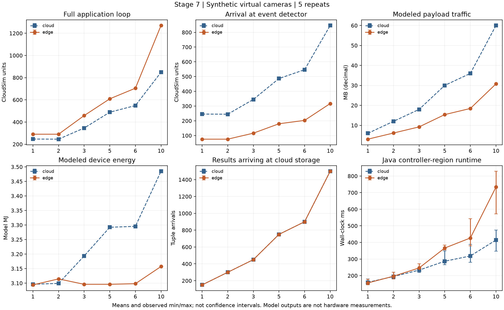
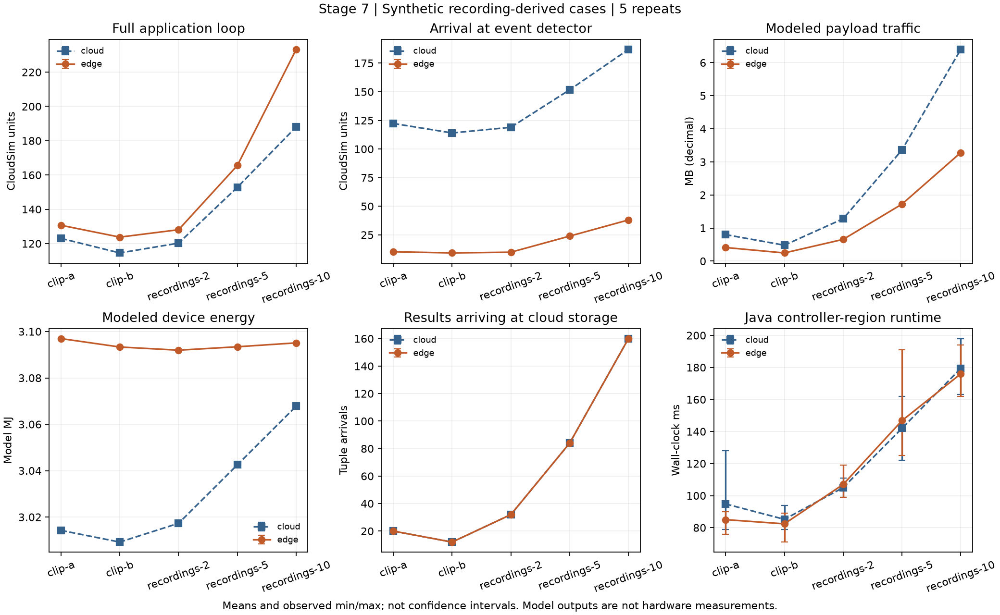

# Stage 7 performance evaluation

Completed 2026-11-17 under the [approved plan](../../research/STAGE7_EVALUATION_PLAN.md). The evaluated production source commit is `1008c5a784dc1b8e2466f64057b2b9d914ff5565`, and the upstream simulator is pinned to `5f68d3947e450d8d2b4af42670be819206be68c9`. New evaluator source was uncommitted during execution; execution-tree and portable source hashes are retained with the evidence.

**This evaluation measures finite workload-placement simulations, plus local pipeline timing on two small synthetic clips. It does not measure a physical multi-camera deployment or reproduce the selected paper's experiments.** All application logic, configuration, model selection, API formats and historical results remain unchanged.

## Design and provenance

Eleven cases, five cloud/edge pairs per case: **110 measured fresh-JVM simulations**, plus one excluded five-camera synthetic warm-up pair. Case order rotates between repetitions and scenario order alternates. Fresh JVMs do not share JIT warm-up. One fixed input identity/profile per case is retained across all five repetitions. Both placements receive identical input; actual profile metadata, counts, source traces and horizons are checked against the input.

| Family | Cases | Workload |
|---|---|---|
| Virtual | 1, 2, 3, 5, 6, 10 cameras | Existing finite sensors, 150 tuples/camera, nominal 0.1-second interval, 15-second arrival window, 2,000-unit horizon. |
| Single recording | clip-a, clip-b | Actual existing Python YOLO26n/ByteTrack analysis of moving-shape fixtures: 20 frames at 10 FPS and 12 frames at 4 FPS, respectively. Both are 160 x 120, not 1080p CCTV. |
| Replicated recording profiles | 2, 5, 10 logical sources | Alternating A/B profile copies with new camera/job IDs. Counts 32, 84, 160; independent 0.1/0.25-second emission intervals. No new footage, extra inference or synchronized physical cameras is implied. |

The two clips were analyzed once each using the production CLI in an isolated pipeline root beneath a new ignored experiment directory. Original configuration was copied; automatic weight downloading was disabled in that copy, and the existing local weights were copied and hash-checked. Original settings/model/workflows were not changed. Profiles/reports, annotated outputs and an unused evidence directory remain in the isolated root; no historical uploads were used or deleted.

Environment: Windows 11 (10.0.26300), Intel64 Family 6 Model 186 Stepping 2, 16 logical CPUs, Python 3.14.0, Node 22.21.0 and Temurin OpenJDK 23.0.2+7. Package versions, model/config/fixture hashes and ordering are recorded in [raw evidence](evidence/stage7-2026-11-17/raw.json) and the [export manifest](evidence/stage7-2026-11-17/export-manifest.json). Other host activity was not controlled; wall-clock results are descriptive observations.

## Metric definitions and assumptions

- Full application loop: camera emission to result tuple arrival at cloud storage. It does not establish that storage computation finished.
- Detector arrival: camera emission to arrival at Event_Detector. It excludes event-detector compute and subsequent cloud delivery.
- Both latency values are **raw CloudSim time units**. Legacy application keys end in `Ms` without conversion; their raw values and historical outputs are preserved. The dashboard correction remains Stage 8 scope. Do not compare these numbers numerically to the paper's stated capture-to-alert milliseconds.
- Traffic is custom counted modeled payload in decimal MB, excluding headers, deployment traffic and local module transfers. Existing defaults are 20,000 camera bytes, 2,000 analyzed bytes and 500 result bytes; selectivity is 1.0, independent of detected events. Edge traffic savings follow these assumptions, not video compression or measured event filtering.
- Existing per-tuple demands are analyzer 1,000 MI, detector 2,000 MI and storage 500 MI. Profile CPU calibration and payload serialization are unavailable, so Java defaults are used. Inference wall time is not converted into calibrated instructions.
- Energy sums cloud/two fog-device counters with configured power models; no camera power or physical meter measurement. Horizons include substantial idle energy. Each paired comparison has an identical horizon; the ten-source recording case uses 2,023 units instead of 2,000 because the existing conservative drain formula expands it. Cross-case energy differences cannot be attributed solely to source count.
- Processed tuples means result arrivals at storage, not decoded frames or confirmed storage-execution completions.
- Java wall-clock runtime measures controller setup through metric collection, excluding build, JVM startup, topology construction and video analysis. External JVM elapsed time is retained separately. Internal simulation horizon is neither wall-clock runtime nor footage duration.

## Findings

All 55 measured pairs passed complete-count, matching-input and horizon checks; all recording sources passed individual emission timing/count checks. All 22 case/scenario combinations exactly repeated their modeled latency, payload, energy and count metrics over five repeats. Host runtimes varied. Repeatability of a deterministic configuration is not a statistical-significance or general-validity claim.

Synthetic cases exactly reproduce all 60 modeled metric means from [Stage 3](STAGE3_ANALYSIS.md), despite the intervening multi-recording implementation. Detector-arrival latency is lower for edge, while full-loop latency remains higher. The edge energy regression at two synthetic cameras remains visible.

For both single clips and every replicated recording case, edge lowered detector-arrival latency and payload traffic but increased full-loop latency and modeled energy. These results do not justify a universal edge advantage. The cloud-storage endpoint and lower fog compute capacity are relevant model features, but this evaluation does not isolate queue/service-time causes or explain energy-counter behavior causally.

The following tables are generated directly from the retained summary. Signed change is `100 * (edge - cloud) / cloud`; positive means larger, not better.

Latency means in raw CloudSim time units:

| Case | Tuples | Horizon | Full loop cloud | Full loop edge | Detector arrival cloud | Detector arrival edge |
|---|---:|---:|---:|---:|---:|---:|
| virtual-1 | 150 | 2000 | 246.597 | 290.293 | 245.635 | 75.398 |
| virtual-2 | 300 | 2000 | 245.637 | 290.293 | 244.634 | 75.398 |
| virtual-3 | 450 | 2000 | 345.946 | 458.140 | 344.947 | 116.019 |
| virtual-5 | 750 | 2000 | 488.544 | 609.212 | 486.526 | 179.947 |
| virtual-6 | 900 | 2000 | 548.566 | 704.798 | 546.532 | 202.621 |
| virtual-10 | 1500 | 2000 | 848.517 | 1270.047 | 846.511 | 317.014 |
| clip-a | 20 | 2000 | 123.018 | 130.673 | 122.302 | 10.249 |
| clip-b | 12 | 2000 | 114.532 | 123.760 | 114.005 | 9.202 |
| recordings-2 | 32 | 2000 | 120.258 | 128.081 | 118.950 | 9.857 |
| recordings-5 | 84 | 2000 | 152.840 | 165.573 | 151.702 | 23.918 |
| recordings-10 | 160 | 2023 | 188.055 | 233.226 | 186.950 | 38.024 |

Signed edge changes relative to cloud:

| Case | Full loop | Detector arrival | Payload traffic | Model energy |
|---|---:|---:|---:|---:|
| virtual-1 | +17.720% | -69.305% | -48.750% | -0.075% |
| virtual-2 | +18.180% | -69.179% | -48.750% | +0.502% |
| virtual-3 | +32.431% | -66.366% | -48.750% | -3.057% |
| virtual-5 | +24.700% | -63.014% | -48.750% | -5.961% |
| virtual-6 | +28.480% | -62.926% | -48.750% | -5.988% |
| virtual-10 | +49.678% | -62.550% | -48.750% | -9.405% |
| clip-a | +6.223% | -91.620% | -48.750% | +2.745% |
| clip-b | +8.057% | -91.928% | -48.750% | +2.796% |
| recordings-2 | +6.505% | -91.714% | -48.750% | +2.475% |
| recordings-5 | +8.331% | -84.234% | -48.750% | +1.673% |
| recordings-10 | +24.020% | -79.661% | -48.750% | +0.890% |

Mean Java controller-region runtime (wall-clock milliseconds):

| Case | Cloud | Edge |
|---|---:|---:|
| virtual-1 | 159.8 | 156.0 |
| virtual-2 | 194.6 | 196.4 |
| virtual-3 | 233.2 | 246.2 |
| virtual-5 | 286.6 | 366.2 |
| virtual-6 | 318.4 | 426.8 |
| virtual-10 | 414.4 | 733.6 |
| clip-a | 94.8 | 85.0 |
| clip-b | 85.2 | 82.4 |
| recordings-2 | 105.0 | 107.0 |
| recordings-5 | 142.0 | 146.8 |
| recordings-10 | 179.4 | 176.0 |

## Local video processing is a different measurement

Each clip was analyzed only once on CPU. Pipeline model-load time is separate from the frame-processing loop, which includes decoding, YOLO/ByteTrack, rules and annotated writing; the latter excludes initial model loading. External CLI elapsed time includes interpreter/import/startup, validation, copying, model loading and report generation. These are different timing boundaries, not repeated inference benchmark samples.

| Clip | Frames/FPS | Model load (s) | Processing loop (s) | Processing FPS | External CLI elapsed (s) |
|---|---|---:|---:|---:|---:|
| clip-a | 20 / 10 | 1.8820 | 2.7827 | 7.187 | 5.5756 |
| clip-b | 12 / 4 | 2.1044 | 2.2327 | 5.375 | 5.2134 |

Both clips contain moving shapes, without labeled people/vehicle/event ground truth. Region-based rules were not configured and were not evaluated. No detection accuracy, safety, tracking robustness, 1080p throughput or live-camera capacity claim follows. The five/ten-source scenarios reuse profile measurements rather than measure five/ten concurrent YOLO workers.

## Figures and retained evidence





Figure x-positions represent the listed tested cases; recording cases are categorical workloads, not equal increments of captured camera count. Error bars are observed min/max around means, not confidence intervals; exact repeats have zero visible modeled-metric error bars. All eight metric summaries, including external JVM elapsed time and horizon, are available in [CSV](evidence/stage7-2026-11-17/summary.csv) and [JSON](evidence/stage7-2026-11-17/summary.json).

The [raw file](evidence/stage7-2026-11-17/raw.json) embeds immutable profile inputs, actual paired outputs, local analysis timings and source hashes. Original Windows raw/profile bytes use CRLF. Versioned raw evidence normalizes only line endings to LF, preserving identical parsed values; summary hash refers to this exported raw file. The export manifest records both raw hashes and LF-normalized source hashes for clean-checkout verification. It explains how to reconstruct embedded original input-profile bytes and their hashes. Downloaded model weights and annotated clips are intentionally excluded from Git.

## Verification and failures

- Production Java build and all 112 scenarios in the final run passed. Source/profile/frame boundaries, complete arrivals, per-source timing and within-pair horizons were validated.
- Fourteen evaluator/reference tests passed, including known statistics, signed worse-edge comparisons, missing/duplicate runs, failed evidence, swapped source identities even when both scenarios match, incomplete arrivals, non-finite/bool/negative metrics, mutated assumptions and the 2,023-unit horizon.
- Existing controlled Java profile checks passed per-camera batching/CPU/payload retention, nine malformed combined profiles rejected before output, and ten-source exact individual shares. These are controlled assumptions, not hardware calibrations.
- Independent audit checked all 176 case/scenario/metric statistical groups, 176 CSV rows, signed comparisons, original source/profile hashes and raw evidence hashes. Both plots were visually inspected and exported plots match those reviewed byte-for-byte.
- No production source/config diff. Original standalone cloud/edge SHA-256 values remain unchanged. No browser verification was required because no runtime/UI file changed.
- An initial evaluation attempt stopped because the new evaluator incorrectly expected 1,000 rather than the existing 2,000 detector MI. The guard was corrected and tested; production code was not changed. That failed attempt remains separately under ignored results and is excluded from all final statistics. An initial audit incorrectly reconstructed Windows profile hashes with LF; it was corrected to audit original file bytes and parsed-value equality. Neither preliminary failure was treated as completed evidence.

## Reproduction

From the project root, after documented dependency/model/submodule setup:

```powershell
.\video_analytics\.venv\Scripts\python.exe -m unittest discover -s simulation/experiments -p "test*.py" -v
.\video_analytics\.venv\Scripts\python.exe simulation/experiments/stage7_evaluation.py
```

The runner creates a unique `results/experiments/stage7-<id>/` directory and refuses an existing explicit `--output` directory. It builds once, derives the two profiles locally and starts fresh JVMs. Each attempted completed pair is saved before validation, so a validation failure retains evidence; failed raw evidence cannot be summarized as complete. Fresh runs have new identities and host timings.

To re-analyze retained evidence without inference or simulation:

```powershell
.\video_analytics\.venv\Scripts\python.exe simulation/experiments/stage7_evaluation.py --analyze simulation/experiments/evidence/stage7-2026-11-17/raw.json --output results/experiments/stage7-reanalysis
```

## Limits and next stage

No physical CCTV, live RTSP, hardware calibration, representative labeled CCTV dataset, accuracy evaluation, dynamic placement, sensitivity sweep or causal energy analysis is supplied by this stage. The [selected-paper alignment](../../research/PAPER_ALIGNMENT.md) remains conceptual; the paper's ambiguous configuration labels and different endpoints prevent a claimed numerical reproduction. New results must remain distinct from paper findings.

Stage 8 should inspect dashboard quality and fix misleading runtime latency labels through a reviewed compatibility plan, preserving historical raw values and existing recovery. Broader responsive/error-state checks also belong to that separately approved stage. No Stage 8 implementation has started.
