# Stage 5 feasibility: 1-10 LAN RTSP cameras at 1080p / 15 FPS

Prepared 2026-11-17 against project commit `cc7d18fb31d3e53598be2a6db097bbb6417379a4`.

**Scope: feasibility study only. No physical IP camera or NVR is confirmed. No live-stream code, camera registration, network scan, camera connection, installation or configuration change was performed.** Uploaded-video and virtual-camera workflows remain unchanged. Requirements below are proposed targets, not implemented features or verified capacity.

## Requirements and feasibility conclusion

The user specifies 1-10 cameras initially, 1920 x 1080 input, 15 FPS, RTSP and a local-network connection to the PC. Hardware is not available yet.

Live ingestion is technically compatible with the existing Python/OpenCV direction, but **1080p/15-FPS analysis for ten cameras is not established on this machine**. Receiving fifteen frames per second and analyzing every frame at that rate are separate requirements. A future implementation must state whether full-frame processing is required; sampling or dropping cannot silently become a claim of full 15-FPS analytics.

Start with one documented camera and a bounded, separately approved trial. Scale to two, five and ten only after measuring decoding, processing, frame age, dropped frames, memory, temperature and disk/network behavior. No purchase SKU or GPU capacity guarantee is justified without a camera model, budget and a real workload benchmark.

## What the current code and machine support

| Item inspected locally | Finding | What it does not prove |
|---|---|---|
| Python/OpenCV | OpenCV 4.14.0; FFmpeg backend available at runtime | A particular camera's RTSP/authentication/codec compatibility |
| Capture API | Open/read timeout constants available; local AVI opened with both 3,000 ms parameters and one frame decoded through FFMPEG | Network timeouts, live reconnection or stream stability |
| PyTorch | CUDA unavailable to the current environment; 12 CPU inference threads reported | Absence of a GPU in hardware, or support for 150 FPS |
| RAM | Windows reports approximately 15.6 GiB total physical memory | Free RAM or safe multi-model capacity |
| Inference resolution | Installed Ultralytics default `imgsz` is 640; detector does not explicitly override it | Native 1080p neural-network inference or sufficient small-object accuracy |
| Separate command-line tools | `ffmpeg` and `ffprobe` not found on PATH | Absence of OpenCV's bundled FFmpeg backend |
| Existing processor | File validation, finite EOF, `frame_index/source_fps` timestamps, one camera per Python run | Safe arbitrary URL handling, live timing or reconnectable sessions |
| Existing coordination | One compute job at a time; finite batch/standalone simulations | Admission control for indefinite live inference plus simultaneous simulation |

The source stream can be 1080p while the detector resizes internally. A future trial must explicitly record input resolution, inference image size, source/decoded/processed FPS and model/device versions; the current small moving-shape fixtures cannot establish 1080p throughput or accuracy.

OpenCV documents that these timeout properties are supplied when opening capture and are backend-specific. Their existence and a successful file read are only readiness checks; live timeout behavior must be measured against the chosen device. [OpenCV Video I/O properties](https://docs.opencv.org/4.x/d4/d15/group__videoio__flags__base.html), [backend availability checks](https://docs.opencv.org/4.11.0/d0/da7/videoio_overview.html).

## Compatible camera or NVR requirements

| Requirement to verify before procurement | Reason / acceptance evidence |
|---|---|
| Explicit local RTSP output, independently accessible without vendor cloud | Manufacturer documentation for the exact model/firmware and a known stream path |
| 1920 x 1080 at 15 FPS on the chosen stream profile | Actual camera/NVR encoder settings and measured decoded resolution/FPS |
| H.264 stream available for the first interoperability trial | A concrete codec target to test with the installed decoder; H.265 is optional and requires its own trial |
| Bitrate and frame-rate controls; documented VBR/maximum-rate behavior | Provision network/storage against the configured and observed rates |
| Read-only streaming account, supported authentication and supported firmware | Avoid giving the analytics process camera-administration privileges |
| Wired LAN and suitable power | Verify Ethernet/PoE standard, per-port draw and switch/injector compatibility for that exact model |
| Optional secondary stream | Useful for a separately approved lower-cost analytics experiment; do not substitute it for the requested 1080p target without disclosure |
| Lens/FOV, lighting/IR and mounting appropriate to the test scene | Resolution alone does not establish person/vehicle visibility or detection accuracy |
| Optional ONVIF interoperability | Verify the precise model and firmware if conformance is claimed; do not infer it from the brand |

Direct RTSP is sufficient for a first manually registered source; ONVIF discovery is not mandatory. Profile T covers advanced IP-video interoperability including H.264/H.265, but optional device features and exact firmware still need checking. ONVIF's directory is its authoritative conformance listing. This is a compatibility filter, not a claim that EdgeVision implements an ONVIF client. [ONVIF Profile T](https://www.onvif.org/profiles/profile-t/), [conformant products](https://www.onvif.org/conformant-products/).

An RTSP-enabled NVR could expose one source per channel, but verify channel count, concurrent stream/session limits, per-channel resolution/FPS and authentication with its manufacturer. An ordinary webcam or replayed local file could support labeled development tests; neither establishes an IP-camera deployment.

## Hardware and local network setup

Proposed physical path: authorized cameras -> suitable powered switch/injectors -> wired switch uplink -> this PC. Use a gigabit PC/switch uplink for the 1-10 camera lab design, with enough switching capacity and headroom for measured peaks and other traffic. A camera's individual Ethernet link need only meet its actual encoded rate; a gigabit uplink does not make inference fast enough.

Count physical ports, including the PC and any router/uplink. Ten directly connected cameras plus one PC already need eleven usable ports; a 16-port class switch is a practical candidate, subject to the required number of powered ports, power budget and uplinks. Choose PoE injectors/switch power only after reading the camera's actual requirements, including IR/PTZ peak draw if applicable. For externally powered cameras, use the specified adapter. No particular camera, switch or GPU has been selected or purchased.

For a future authorized trial:

1. Obtain model/firmware documentation, supported codec/profile, streaming account and stream path privately.
2. Connect the camera and PC to the approved LAN; use DHCP reservation or a documented static address. Do not change the PC's current network settings as part of this study.
3. Configure the selected camera profile for 1080p/15 FPS and a documented bitrate policy. Record actual negotiated values rather than trusting a product label.
4. Allow only the required PC-to-camera paths under the network owner's policy. Start with explicitly registered unicast sources; automatic discovery/scanning is outside scope.
5. Try RTSP interleaved TCP as an initial compatibility choice, then measure delay/loss behavior. TCP is not inherently lower-latency or encrypted. UDP can be evaluated later with the camera's documented port behavior.

FFmpeg documents RTSP TCP/UDP transports and a socket timeout setting; selecting the appropriate backend/transport is a future implementation detail to test, not a setting already applied to EdgeVision. [FFmpeg RTSP documentation](https://ffmpeg.org/ffmpeg-protocols.html#rtsp).

## Bandwidth and retention calculations

Resolution/FPS alone do not determine compressed bitrate. Scene activity, codec and encoder settings matter; bitrate limits can affect quality. Therefore 2, 4 and 8 Mb/s below are **planning scenarios**, not asserted requirements or measurements for a camera. [Manufacturer discussion of bitrate control](https://whitepapers.axis.com/en-us/bitrate-control-for-ip-video).

Decimal units: `payload Mb/s = cameras * encoded Mb/s per camera`; `GB/hour = cameras * bitrate * 0.45`; `GB/day = cameras * bitrate * 10.8`. Protocol overhead, VBR peaks, audio, duplicated streams, annotated outputs and metadata are excluded.

| Cameras | Source FPS total | Network at 2 / 4 / 8 Mb/s per camera | Encoded storage/hour at 4 Mb/s | Encoded storage/day at 4 Mb/s |
|---:|---:|---:|---:|---:|
| 1 | 15 | 2 / 4 / 8 Mb/s | 1.8 GB | 43.2 GB |
| 2 | 30 | 4 / 8 / 16 Mb/s | 3.6 GB | 86.4 GB |
| 5 | 75 | 10 / 20 / 40 Mb/s | 9.0 GB | 216 GB |
| 10 | 150 | 20 / 40 / 80 Mb/s | 18.0 GB | 432 GB |

At ten cameras, the 2-8 Mb/s scenarios span 216-864 GB/day if every compressed input stream is recorded continuously. A sixty-second capture at 4 Mb/s would contain approximately 30 MB/camera or 300 MB for ten cameras, before overhead. These figures are arithmetic illustrations, not a proposed continuous-recording retention commitment.

The existing 500 MiB/file and 1 GiB/batch input limits are upload limits, not live recording quotas. Future sessions need their own duration, disk budget and explicit retention policy. Annotated/re-encoded outputs may need additional space. Do not silently delete historical Stage 1-4 artifacts; stop accepting new session output when its approved quota is reached and surface the reason.

## Decode, inference and memory sizing

One decoded 1920 x 1080 8-bit BGR frame is `1920 * 1080 * 3 = 6,220,800` bytes, approximately **5.93 MiB**. A two-frame queue for each of ten cameras alone takes approximately **118.65 MiB**. This excludes FFmpeg decode buffers, Python/Torch/YOLO model state, tracker histories, copies, annotated frames and reports.

At 15 FPS, decoded BGR data represents about **88.99 MiB/s per camera**, or **889.89 MiB/s for ten**, before extra copies. That is a host-side decoded-data calculation, not the compressed LAN bitrate.

| Cameras | Full-frame analysis demand | Average budget per frame for a hypothetical single serial processing lane |
|---:|---:|---:|
| 1 | 15 FPS | 66.67 ms |
| 2 | 30 FPS | 33.33 ms |
| 5 | 75 FPS | 13.33 ms |
| 10 | 150 FPS | 6.67 ms |

These budgets are `1000 / (15 * cameras)` and include all work assigned to that lane; they are not measured inference times. Real pipelines can overlap work, but decoding, tracking and rule evaluation still consume resources. The installed CPU environment has not demonstrated any row's end-to-end target. Benchmark before proposing GPU/CPU upgrades; no hardware recommendation can guarantee throughput without the chosen model, inference size and scene workload.

Do not share one mutable YOLO/ByteTrack state between camera workers. A future one-camera worker should own its model/tracker. Additional dedicated workers increase model memory and may oversubscribe the currently reported CPU-thread settings; worker count and thread budgets need measurements. Ultralytics explicitly recommends isolated model ownership for threaded inference. [Ultralytics concurrency guidance](https://docs.ultralytics.com/guides/yolo-thread-safe-inference/).

## Proposed software architecture, not implemented

```mermaid
flowchart LR
    C[Authorized LAN RTSP cameras] --> A[Per-camera bounded acquisition]
    A --> Q[Bounded buffers and explicit drop accounting]
    Q --> P[Camera-owned local YOLO and ByteTrack]
    P --> R[Per-camera rules and timestamped analytics]
    R --> W[Immutable finite workload windows]
    W --> S[Paired iFogSim runs on the same window]
    S --> D[Separate live-window comparison]
```

Keep the existing file validator and uploaded-video paths intact. Live sources need a separate registered-source adapter; changing a file path to an RTSP string in the current CLI is not sufficient. No new simulation framework is proposed.

The adapter would need explicit open/read deadlines, cancellation, bounded queues and source health. Candidate states are registered, connecting, streaming, reconnecting, stopped and failed. A failed live read must not become a successful EOF. Use bounded retry/backoff and expose outages; resetting a tracker after a reconnect must start a new camera/session epoch so reused tracking IDs cannot be treated as uninterrupted identities. Time-based rules must not accumulate apparent dwell time across an unobserved outage.

Frame index divided by nominal FPS is unsuitable for live gaps/drops. Record source timestamps when trustworthy, monotonic receipt/processing times, optional UTC correlation, decoded/processed/dropped counts, coverage and reconnect epochs separately. Without trustworthy source-clock synchronization, do not claim exact camera-capture-to-output latency or synchronized cross-camera footage. Existing global region rules also need a reviewed per-camera configuration approach before heterogeneous views are evaluated.

Continuous observations must be closed into immutable finite windows before iFogSim comparison. The current profile schema represents regular intervals, so real dropped/jittered windows need an explicit timestamp-trace extension or a clearly disclosed aggregation assumption. Never pad an outage with fabricated frames/events. Retain camera IDs, window IDs, coverage and actual generated tuple counts; use exactly the same frozen window in cloud and edge. Empty/unavailable cameras must remain visible. Physical inference stays local; iFogSim still models placement rather than executing YOLO on real fog/cloud nodes.

The existing global compute lock cannot be held indefinitely and quietly bypassed for concurrent simulations. A bounded first trial can retain exclusive ownership, finish acquisition/analysis, then run paired simulation. Continuous multi-camera processing requires a separately reviewed admission/resource policy; this study does not change the lock or enable concurrent jobs.

## Credentials and stream security requirements

Register only specifically authorized camera hosts/ports. Validate destinations server-side rather than accepting arbitrary URLs that could reach local services or unrelated network endpoints. Do not perform discovery scans or open router port forwarding for this prototype. Keep the dashboard localhost-only; any remote access or authentication changes require a separate plan.

Use a least-privilege streaming account and an approved secret store (for example a Windows-managed credential reference). Keep secrets out of Git, JSON reports, browser storage, shell/process arguments and logs. A future worker can receive a camera ID and resolve its secret privately. Native decoder stderr must be captured/redacted before display or persistence; malformed-URL and credential-failure tests are required. No credentials are requested or stored during this study.

Do not treat RTSP-over-TCP or an HTTPS administration page as proof of encrypted video. Camera/backend support must be checked for both protected signaling and protected media. Axis distinguishes RTSPS signaling protection from SRTP media protection; exact device/client behavior still needs testing. Use an approved isolated LAN design if an authorized camera cannot provide the required encrypted transport, without weakening PC security settings or bypassing certificate validation. [RTSP(S) and (S)RTP transport](https://developer.axis.com/video-streaming-and-recording/video-streaming/concepts/protocols-and-transport-capabilities/).

## Future setup and approval gates

No implementation is requested or authorized now. If hardware becomes available, prepare a concrete plan for approval:

1. **Inventory and compatibility:** exact model/firmware, RTSP profile/codec, power/network topology, account privileges, stream limits and budget. Validate only the authorized source.
2. **Bounded one-camera ingestion trial:** 1080p/15-FPS source, explicit short session, no automatic archive deletion. Verify negotiated media and failure/stop behavior. An optional capture-then-analyze trial must be labeled delayed analysis of a recorded live segment, not continuous live inference.
3. **One-camera live analytics:** timestamp/rule semantics, fresh-frame policy, per-camera regions, tracker resets, coverage and log redaction. Decide whether every frame must be analyzed or a sampled mode is acceptable. Neither outcome is assumed here.
4. **Scale admission:** test two, five and ten cameras only if each lower count meets the agreed performance/resource criteria. Preserve the source's 1080p/15-FPS requirement; any resolution/FPS reduction needs explicit approval and labeling.
5. **Windowed comparison:** validate an appropriate finite profile representation, use paired identical inputs, preserve recovery and retain existing uploaded/synthetic workflows. Correct the known latency-unit contract before interpreting live and simulated latency together.

Acceptance evidence should include actual source/decoded/processed FPS, missing/dropped frames, receipt-to-result age, CPU/RAM and disk/network measurements, reconnect/cancel tests, cross-camera identity isolation, per-camera rules and paired profile/count equality. Proposed open/read deadlines or freshness thresholds are test parameters to agree and verify, not a delivered SLA. A camera disconnect must be shown as unavailable, not safe footage with zero events.

## Work completed and unverified items

Completed: current-code inspection; local RAM/backend/CUDA/default-inference-size/tool availability checks; local FFmpeg file-open/read with timeout parameters; independently checked capacity arithmetic; official documentation review; this conditional hardware/network/software plan.

Not tested: any physical camera or NVR, RTSP authentication, network timeout/reconnect behavior, H.264/H.265 live decode, real 1080p/15-FPS throughput, multi-stream capacity, live tracking/rules, transport encryption or sustained resource usage. No stream was connected, and no ordinary file/webcam was presented as a deployed CCTV network. See [readiness evidence](../research/stage5-readiness.json).

The feasibility investigation is complete under the user's requirements; live implementation remains unapproved and hardware-dependent. The next roadmap stage is reference-paper alignment (Stage 6), which requires its own approval and the actual selected paper.
